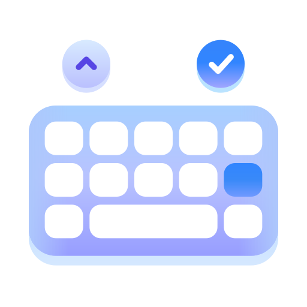
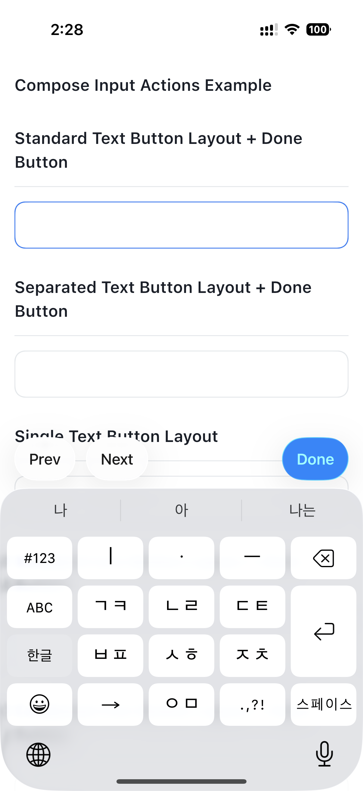
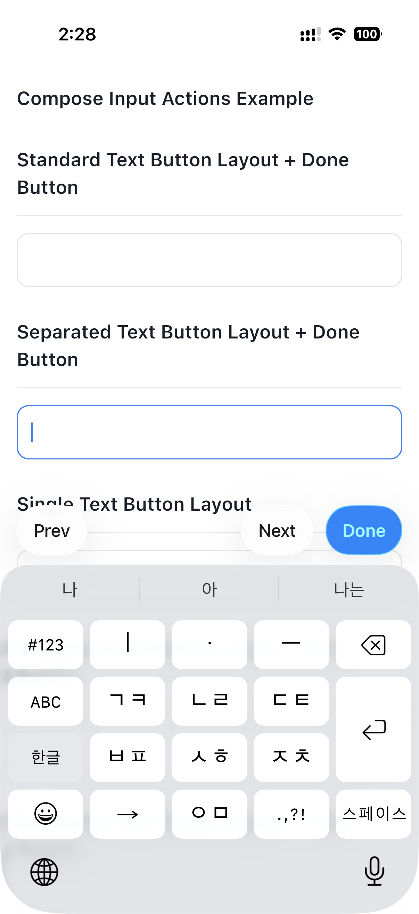
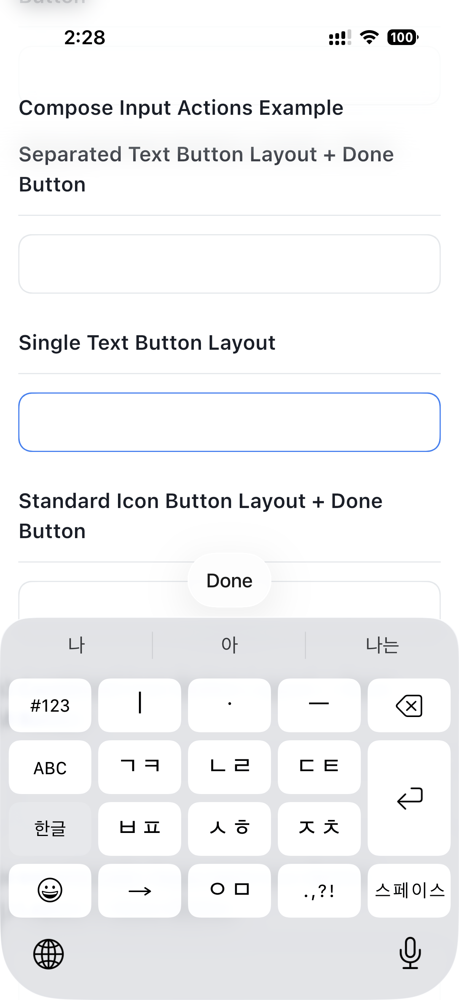
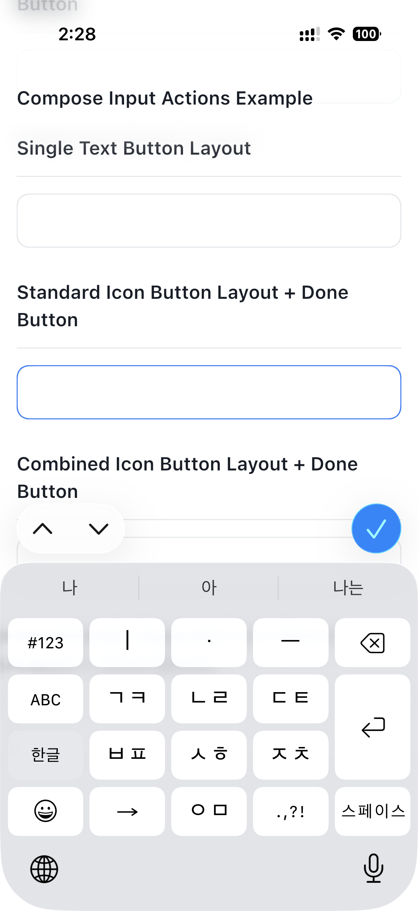
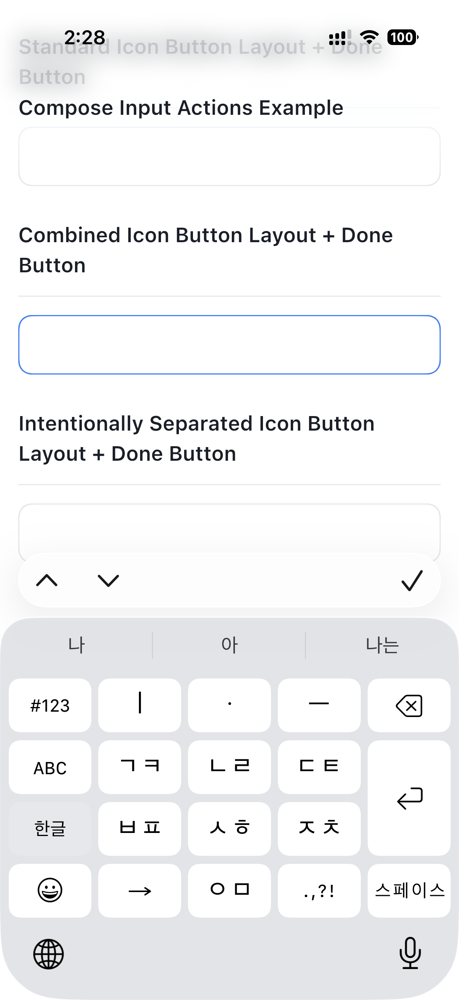
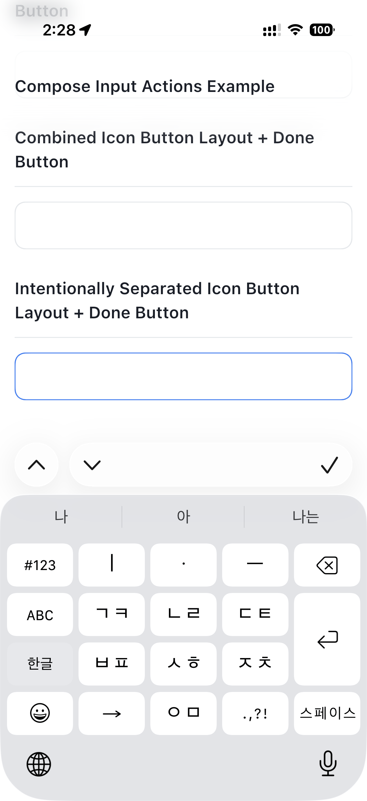

<p align="center">
  
</p>

# Compose Input Actions

Native iOS keyboard toolbars for Compose text fields, with a shared Kotlin Multiplatform API.

**English** | [한국어](README_ko.md)

[](https://central.sonatype.com/artifact/zone.ien.inputactions/inputactions)
[](gradle/libs.versions.toml)
[](gradle/libs.versions.toml)
[](#platform-support)
[](LICENSE)

<a id="overview"></a>

## Overview

Add native input accessories to ordinary [Compose Multiplatform](https://kotlinlang.org/docs/multiplatform/compose-multiplatform.html) `TextField`, `OutlinedTextField`, and `BasicTextField` components without replacing them with UIKit text fields. Compose continues to own text state and focus.

On iOS, a host uses Compose’s public platform text-input interception APIs to supply a native [UIToolbar](https://developer.apple.com/documentation/uikit/uitoolbar) as the active text-input session’s accessory view. The same common API is available on other configured targets, where native accessory rendering is currently a no-op.

<a id="contents"></a>

## Table of Contents

- [Overview](#overview)
- [Preview](#preview)
- [Features](#features)
- [Platform Support](#platform-support)
- [Installation](#installation)
- [Quick Start](#quick-start)
- [Usage Examples](#usage)
  - [Move Between Fields and Clear Focus](#usage-navigation)
  - [Space Actions and Separate Background Groups](#usage-groups)
  - [Update Actions While Focused](#usage-dynamic)
- [API Reference](#api-reference)
- [Compatibility & Limitations](#compatibility)
- [Development](#development)
  - [Build and Test](#development-build)
  - [Run the Sample](#development-sample)
- [License & Attribution](#license)

<a id="preview"></a>

## Preview

Six iOS sample configurations; select an image to view it at full resolution.

<p align="center">
  <a href="images/sample_01_en.PNG"></a>
  <a href="images/sample_02_en.PNG"></a>
  <a href="images/sample_03_en.PNG"></a>
</p>
<p align="center">
  <a href="images/sample_04_en.PNG"></a>
  <a href="images/sample_05_en.PNG"></a>
  <a href="images/sample_06_en.PNG"></a>
</p>

<a id="features"></a>

## Features

- **Modifier API** — Attach actions to each field with [`Modifier.inputActions`](#api-modifier), under a shared host.
- **Focus-aware registration** — Switch action sets with field focus, update registered actions while focused, and remove registrations when nodes detach.
- **Native toolbar items** — Use text, SF Symbols, `Plain` / `Done` styles, and flexible spacing with UIKit’s toolbar appearance.
- **iOS 26 background groups** — Hide an item’s shared background or separate adjacent groups with [explicit spacing](#usage-groups).
- **Keyboard-only completion** — [`InputAction.Done()`](#api-factories) hides the software keyboard while preserving focus; custom callbacks can clear focus or move between fields.
- **Shared multiplatform code** — Keep the same declarations on Android, JVM, macOS, and Wasm JS with no native accessory rendering on those targets.

<a id="platform-support"></a>

## Platform Support

| Platform | Configured targets | Native accessory support |
| --- | --- | --- |
| iOS | `iosArm64`, `iosSimulatorArm64` | Implemented with UIKit |
| Android | Android library | No-op |
| Desktop (JVM) | `jvm` | No-op |
| macOS | `macosArm64` | No-op |
| Web (Wasm JS) | `wasmJs` browser | No-op |

No-op targets retain common registration behavior but do not display toolbar items or provide native toolbar taps. There are no configured `iosX64`, `macosX64`, or JavaScript (`js`) targets.

| Feature | Android support | iOS support | Implementation |
| --- | --- | --- | --- |
| Host and focus registration | Common registry | Common registry | CompositionLocal and Modifier nodes |
| Text / icon actions and styles | No native UI | Implemented | `UIBarButtonItem`, SF Symbols |
| Flexible spacing | No native UI | Implemented | Native flexible-space items |
| Updates to an existing toolbar | No native UI | Implemented | Replace items in the current toolbar |
| Shared background controls | No native UI | iOS 26+ | UIKit background properties and separator items |

This table describes the current implementation, not a device or accessibility certification. See [limitations](#compatibility).

<a id="installation"></a>

## Installation

The verified Maven Central release is [`zone.ien.inputactions:inputactions:1.0.0`](https://central.sonatype.com/artifact/zone.ien.inputactions/inputactions/1.0.0). The current checkout declares `1.0.1` in the [version catalog](gradle/libs.versions.toml); that is the source version, not a confirmed Central release.

Add the repositories if your project does not already declare them, then add the dependency to your shared module:

```kotlin
// settings.gradle.kts
pluginManagement {
    repositories {
        google()
        mavenCentral()
        gradlePluginPortal()
    }
}
dependencyResolutionManagement {
    repositories {
        google()
        mavenCentral()
    }
}
```

```kotlin
// build.gradle.kts (shared module)
kotlin {
    sourceSets {
        commonMain.dependencies {
            implementation("zone.ien.inputactions:inputactions:1.0.0")
        }
    }
}
```

Alternatively, use a Version Catalog:

```toml
# gradle/libs.versions.toml
[versions]
inputactions = "1.0.0"

[libraries]
inputactions = { module = "zone.ien.inputactions:inputactions", version.ref = "inputactions" }
```

```kotlin
commonMain.dependencies {
    implementation(libs.inputactions)
}
```

**Platform setup:** Place `InputActionsHost` around the relevant UI as shown in [Quick Start](#quick-start). This library requires no separate SPM package or custom `MainViewController` integration on iOS. Configure your application’s regular Compose Multiplatform targets as usual. On other targets the host adds no native accessory UI.

> [!IMPORTANT]
> The current checkout is configured with Kotlin **2.4.21**, Compose Multiplatform **1.12.2**, AGP **9.3.1**, Gradle **9.5.1**, and JDK **17**. These are repository build versions, not a tested minimum compatibility range for consumers. See [Compatibility & Limitations](#compatibility).

<a id="quick-start"></a>

## Quick Start

This example uses Material 3’s `OutlinedTextField`; your app must also depend on Compose Material 3. The library itself depends on Compose UI, Foundation, and Runtime, not Material 3.

```kotlin
import androidx.compose.material3.OutlinedTextField
import androidx.compose.material3.Text
import androidx.compose.runtime.Composable
import androidx.compose.runtime.getValue
import androidx.compose.runtime.mutableStateOf
import androidx.compose.runtime.remember
import androidx.compose.runtime.setValue
import androidx.compose.ui.Modifier
import zone.ien.inputactions.InputAction
import zone.ien.inputactions.InputActionsHost
import zone.ien.inputactions.inputActions

@Composable
fun NoteField() {
    var text by remember { mutableStateOf("") }

    InputActionsHost {
        OutlinedTextField(
            value = text,
            onValueChange = { text = it },
            modifier = Modifier.inputActions(InputAction.Done()),
            label = { Text(text = "Note") },
        )
    }
}
```

`Done()` is a composable factory. It hides the software keyboard without clearing focus and does nothing if no keyboard controller is available. Put one host around the relevant screen or app subtree; individual fields do not each need a host. Without a host, `inputActions` does not register actions.

<a id="usage"></a>

## Usage Examples

<a id="usage-navigation"></a>

### Move Between Fields and Clear Focus

Use Compose `FocusRequester` for navigation. The first field uses the keyboard-only `Done()` helper; the second uses a labeled custom action that clears focus.

```kotlin
import androidx.compose.foundation.layout.Column
import androidx.compose.material3.OutlinedTextField
import androidx.compose.material3.Text
import androidx.compose.runtime.*
import androidx.compose.ui.Modifier
import androidx.compose.ui.focus.FocusRequester
import androidx.compose.ui.focus.focusRequester
import androidx.compose.ui.platform.LocalFocusManager
import zone.ien.inputactions.*

@Composable
fun RegistrationForm() {
    var name by remember { mutableStateOf("") }
    var email by remember { mutableStateOf("") }
    val nameFocus = remember { FocusRequester() }
    val emailFocus = remember { FocusRequester() }
    val focusManager = LocalFocusManager.current

    InputActionsHost {
        Column {
            OutlinedTextField(
                value = name,
                onValueChange = { name = it },
                modifier = Modifier
                    .focusRequester(nameFocus)
                    .inputActions(
                        InputAction(
                            title = "Next",
                            icon = InputActionIcon("chevron.down"),
                            onClick = { emailFocus.requestFocus() },
                        ),
                        InputAction.Done(),
                    ),
                label = { Text(text = "Name") },
            )
            OutlinedTextField(
                value = email,
                onValueChange = { email = it },
                modifier = Modifier
                    .focusRequester(emailFocus)
                    .inputActions(
                        InputAction(
                            title = "Previous",
                            icon = InputActionIcon("chevron.up"),
                            onClick = { nameFocus.requestFocus() },
                        ),
                        InputAction(
                            title = "Done",
                            style = InputActionStyle.Done,
                            onClick = { focusManager.clearFocus() },
                        ),
                    ),
                label = { Text(text = "Email") },
            )
        }
    }
}
```

<a id="usage-groups"></a>

### Space Actions and Separate Background Groups

Inside the form above, this modifier places Next and Clear on the left, with a separate Done group on iOS 26 and later:

```kotlin
Modifier.inputActions(
    InputAction(title = "Next", onClick = { emailFocus.requestFocus() }),
    InputAction(title = "Clear", onClick = { name = "" }),
    InputAction.FlexibleSpace(separatesSharedBackground = true),
    InputAction(
        title = "Done",
        style = InputActionStyle.Done,
        onClick = { focusManager.clearFocus() },
    ),
)
```

Without an explicit `FlexibleSpace`, the toolbar inserts one before the final action when there are multiple actions, or before a single `Done`-style action. An explicit spacer gives you control over the boundary.

- `separatesSharedBackground = true` keeps both groups’ backgrounds visible. On a regular action the separator goes **before** the action; on a flexible spacer it goes **after** the gap.
- `hidesSharedBackground = true` removes the item’s shared background instead. It does not mean “start a separate group.”
- Both flags affect only iOS 26+. Earlier versions retain the regular toolbar appearance and flexible spacing.

<a id="usage-dynamic"></a>

### Update Actions While Focused

Inside `InputActionsHost` in the Quick Start example, replace the field declaration with the following. Clear appears when text is nonempty:

```kotlin
val clearAction = InputAction(title = "Clear", onClick = { text = "" })
val doneAction = InputAction.Done()
val actions = if (text.isEmpty()) {
    listOf(doneAction)
} else {
    listOf(clearAction, doneAction)
}

OutlinedTextField(
    value = text,
    onValueChange = { text = it },
    modifier = Modifier.inputActions(*actions.toTypedArray()),
)
```

Registered actions and an existing toolbar’s items are updated while the field is focused. Attaching a new accessory after an input session started without one has a separate limitation described [below](#compatibility).

See the [sample screen](example/composeApp/src/commonMain/kotlin/zone/ien/inputaction/example/App.kt) for six text, icon, spacing, and background configurations.

<a id="api-reference"></a>

## API Reference

<a id="api-host"></a>

### InputActionsHost

[`InputActionsHost(content: @Composable () -> Unit)`](library/src/commonMain/kotlin/zone/ien/inputactions/InputActionsHost.kt) supplies the internal registry and platform integration to its content. `content` is required; the registry is disposed with the host.

<a id="api-modifier"></a>

### Modifier.inputActions

[`Modifier.inputActions(vararg actions: InputAction): Modifier`](library/src/commonMain/kotlin/zone/ien/inputactions/InputActionsModifier.kt) registers the actions while the field owns focus. Zero or more actions are accepted; an empty list supplies no actions. Focus loss or node detachment removes the registration. No caller-assigned field ID is needed.

<a id="api-action"></a>

### InputAction

The public constructor in [`InputAction.kt`](library/src/commonMain/kotlin/zone/ien/inputactions/InputAction.kt):

```kotlin
InputAction(
    title: String = "",
    style: InputActionStyle = InputActionStyle.Plain,
    icon: InputActionIcon? = null,
    hidesSharedBackground: Boolean = false,
    separatesSharedBackground: Boolean = false,
    onClick: () -> Unit,
)
```

| Parameter | Type | Default | Behavior |
| --- | --- | --- | --- |
| `title` | `String` | `""` | Button text; retained as a human-readable title when an icon is shown |
| `style` | `InputActionStyle` | `Plain` | Native presentation style |
| `icon` | `InputActionIcon?` | `null` | SF Symbol displayed instead of text on iOS; falls back to title if lookup fails |
| `hidesSharedBackground` | `Boolean` | `false` | Hide the item’s shared background on iOS 26+ |
| `separatesSharedBackground` | `Boolean` | `false` | Insert a native group separator on iOS 26+ |
| `onClick` | `() -> Unit` | Required | Callback for the action |

All constructor values are exposed as read-only properties. `isFlexibleSpace: Boolean` is also read-only and is set by spacer factories, not by the public constructor. A spacer’s title and callback are not used as a visible action.

<a id="api-factories"></a>

### Factories, Styles, and Icons

| API | Defaults / behavior |
| --- | --- |
| `@Composable InputAction.Done(icon, style)` | `icon = InputActionIcon("checkmark")`, `style = InputActionStyle.Done`; hides the software keyboard and retains focus |
| `InputAction.FlexibleSpace` | Flexible spacer with both background flags `false` |
| `InputAction.FlexibleSpace(hidesSharedBackground, separatesSharedBackground)` | Both Boolean arguments default to `false` |
| `InputAction.flexibleSpace(hidesSharedBackground, separatesSharedBackground)` | Lowercase alias with identical defaults and behavior |
| `InputActionStyle.Plain` | Regular native button style |
| `InputActionStyle.Done` | Emphasized native button style; does not itself dismiss the keyboard |
| `InputActionIcon(systemName: String)` | Data class holding an SF Symbol name on iOS |

Use a meaningful `title` on custom icon actions so UIKit can retain a human-readable label. Symbol availability depends on the iOS version. `Done()` has no title parameter; use the constructor for a labeled Done action. Passing `icon = null` to `Done()` produces an empty title with no icon.

<a id="compatibility"></a>

## Compatibility & Limitations

- **Build baseline:** See the [version catalog](gradle/libs.versions.toml), [library build](library/build.gradle.kts), and [Gradle wrapper](gradle/wrapper/gradle-wrapper.properties). Android uses `minSdk 29` and `compileSdk 37`; the sample uses `targetSdk 37`. JVM compilation targets Java 17. The sample’s Xcode project sets iOS **18.2** as its deployment target; this is not a verified minimum for the published library.
- **Compose integration:** The iOS implementation uses public but experimental `InterceptPlatformTextInput` / platform IME option APIs. It does not traverse UIKit view hierarchies, swizzle responders, or create a competing hidden `UITextField`. Compatibility with arbitrary Compose releases is not guaranteed.
- **Input-session boundary:** The accessory is selected when Compose starts a platform input session. Existing toolbar items can be updated, but changing from no accessory to nonempty actions during the same session does not explicitly request a new accessory attachment. A new input session may be required.
- **Existing custom accessory:** When library actions are active, the supplied toolbar replaces the request’s existing `inputAccessoryView`; it is not merged with a custom accessory. Other explicitly copied platform IME settings, including `inputView`, are forwarded. With no active actions, the original request is passed through.
- **Focus and keyboard visibility:** Hiding the software keyboard does not clear focus. The library does not supply hardware keyboard shortcuts or an alternative toolbar when the software keyboard is hidden.
- **Native appearance:** Background grouping options apply only to iOS 26+. The system controls toolbar appearance; the library does not draw custom group backgrounds.
- **Verification scope:** Common tests cover action values and registry transitions. iOS tests cover toolbar items, updates, symbols, spacing, and the accessory container. These do not establish end-to-end text editing, VoiceOver, hardware keyboard, IME, or all OS/device behavior.

<a id="development"></a>

## Development

Use JDK 17 and the checked-in wrapper. Android tasks require SDK 37; iOS builds and tests require macOS and Xcode.

<a id="development-build"></a>

### Build and Test

```bash
./gradlew :library:assemble
./gradlew :library:jvmTest
./gradlew :library:iosSimulatorArm64Test
```

`assemble` builds the configured library outputs. `jvmTest` runs common tests on JVM; `iosSimulatorArm64Test` runs common and iOS tests on an Apple Silicon simulator. A compatible simulator must be available. See [common tests](library/src/commonTest/kotlin/zone/ien/inputactions/InputActionTest.kt) and [iOS tests](library/src/iosTest/kotlin/zone/ien/inputactions/IosInputActionsHostTest.kt).

<a id="development-sample"></a>

### Run the Sample

The [sample app](example/) contains Android, iOS, and Wasm JS entry points using the public API. Its [shared screen](example/composeApp/src/commonMain/kotlin/zone/ien/inputaction/example/App.kt) demonstrates standard text actions, explicit spacing, a single Done action, icon actions, hidden backgrounds, and separate icon groups.

```bash
# Android: install on a connected device or emulator
./gradlew :example:androidApp:installDebug

# Web: start the Wasm JS development server
./gradlew :example:composeApp:wasmJsBrowserDevelopmentRun

# iOS: open the Xcode project
open example/iosApp/iosApp.xcodeproj
```

For iOS, choose the `iosApp` scheme and an Apple Silicon simulator or physical device. Xcode’s build phase invokes Gradle to build and embed the Compose framework. For physical devices, select your own signing team and bundle identifier in Xcode / [Config.xcconfig](example/iosApp/Configuration/Config.xcconfig). There is no JVM or macOS sample entry point.

<a id="license"></a>

## License & Attribution

Released under the [Apache License 2.0](LICENSE). The existing project and IENLAB copyright notices are retained below.

```text
Copyright (c) 2026. Compose Input Actions project and open source contributors.
Copyright (c) 2026. IENGROUND of IENLAB.

Licensed under the Apache License, Version 2.0 (the "License");
you may not use this file except in compliance with the License.
You may obtain a copy of the License at

    http://www.apache.org/licenses/LICENSE-2.0

Unless required by applicable law or agreed to in writing, software
distributed under the License is distributed on an "AS IS" BASIS,
WITHOUT WARRANTIES OR CONDITIONS OF ANY KIND, either express or implied.
See the License for the specific language governing permissions and
limitations under the License.
```
