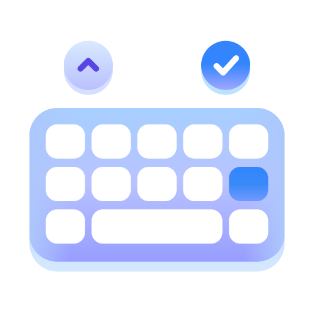
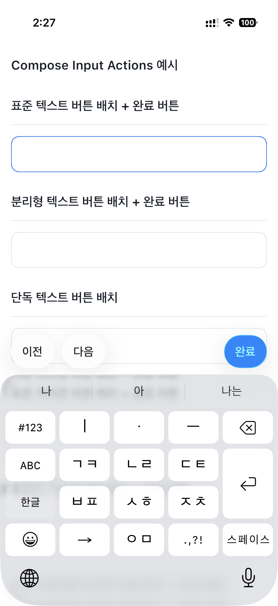
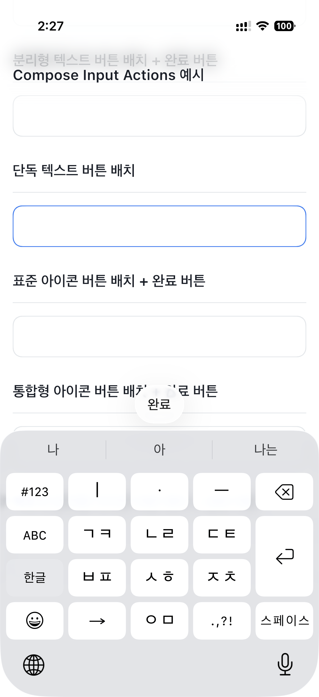
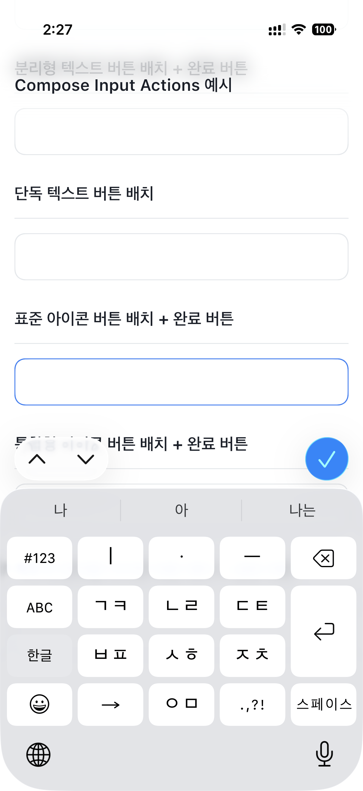
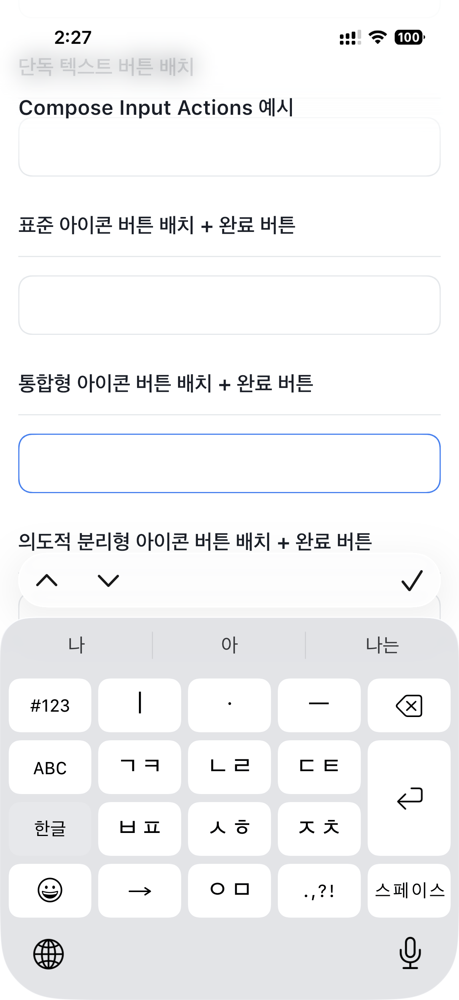
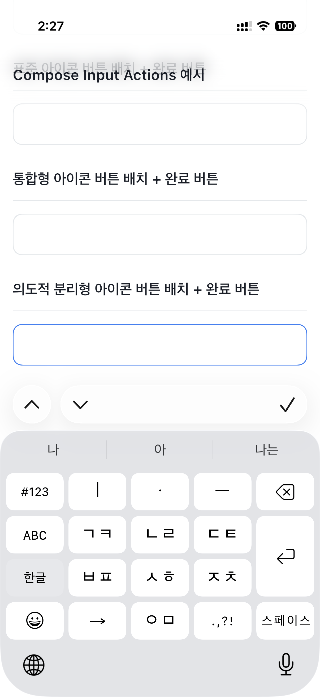

<p align="center">
  
</p>

# Compose Input Actions

공통 Kotlin Multiplatform API로 Compose 텍스트 필드에 iOS 네이티브 키보드 툴바를 추가합니다.

[English](README.md) | **한국어**

[](https://central.sonatype.com/artifact/zone.ien.inputactions/inputactions)
[](gradle/libs.versions.toml)
[](gradle/libs.versions.toml)
[](#platform-support)
[](LICENSE)

<a id="overview"></a>

## 개요

일반적인 [Compose Multiplatform](https://kotlinlang.org/docs/multiplatform/compose-multiplatform.html) `TextField`, `OutlinedTextField`, `BasicTextField`에 네이티브 입력 액세서리를 추가합니다. UIKit 텍스트 필드로 교체하지 않으며, 텍스트 상태와 포커스는 Compose가 계속 관리합니다.

iOS에서는 호스트가 Compose의 공개 플랫폼 텍스트 입력 인터셉터 API를 통해 활성 입력 세션에 네이티브 [UIToolbar](https://developer.apple.com/documentation/uikit/uitoolbar)를 액세서리 뷰로 전달합니다. 다른 설정된 타깃에서도 동일한 공통 API를 사용할 수 있지만, 네이티브 액세서리 표시는 현재 no-op입니다.

<a id="contents"></a>

## 목차

- [개요](#overview)
- [미리보기](#preview)
- [주요 기능](#features)
- [플랫폼 지원](#platform-support)
- [설치](#installation)
- [빠른 시작](#quick-start)
- [사용 예제](#usage)
  - [필드 간 이동 및 포커스 해제](#usage-navigation)
  - [액션 간격 및 배경 그룹 분리](#usage-groups)
  - [포커스 유지 중 액션 갱신](#usage-dynamic)
- [API 레퍼런스](#api-reference)
- [호환성 및 제약 사항](#compatibility)
- [개발](#development)
  - [빌드 및 테스트](#development-build)
  - [샘플 실행](#development-sample)
- [라이선스 및 저작권](#license)

<a id="preview"></a>

## 미리보기

iOS 샘플의 여섯 가지 구성입니다. 이미지를 선택하면 원본 크기로 볼 수 있습니다.

<p align="center">
  <a href="images/sample_01_ko.PNG"></a>
  <a href="images/sample_02_ko.PNG"></a>
  <a href="images/sample_03_ko.PNG"></a>
</p>
<p align="center">
  <a href="images/sample_04_ko.PNG"></a>
  <a href="images/sample_05_ko.PNG"></a>
  <a href="images/sample_06_ko.PNG"></a>
</p>

<a id="features"></a>

## 주요 기능

- **Modifier API** — 공통 호스트 안에서 [`Modifier.inputActions`](#api-modifier)로 필드마다 액션을 지정합니다.
- **포커스 연동 등록** — 필드 포커스에 따라 활성 액션을 전환하고, 포커스 유지 중 등록된 액션을 갱신하며, 노드 분리 시 등록을 해제합니다.
- **네이티브 툴바 항목** — 텍스트, SF Symbols, `Plain` / `Done` 스타일, 가변 간격을 UIKit 툴바 외형으로 표시합니다.
- **iOS 26 배경 그룹** — 항목의 공유 배경을 숨기거나 [명시적 간격](#usage-groups)으로 인접 그룹을 분리합니다.
- **키보드만 닫는 완료 액션** — [`InputAction.Done()`](#api-factories)은 포커스를 유지하며 소프트웨어 키보드를 닫습니다. 사용자 콜백으로 포커스를 해제하거나 다른 필드로 이동할 수도 있습니다.
- **멀티플랫폼 공통 코드** — Android, JVM, macOS, Wasm JS에서도 동일한 선언을 유지할 수 있습니다. 해당 타깃에는 네이티브 액세서리가 표시되지 않습니다.

<a id="platform-support"></a>

## 플랫폼 지원

| 플랫폼 | 설정된 타깃 | 네이티브 액세서리 지원 |
| --- | --- | --- |
| iOS | `iosArm64`, `iosSimulatorArm64` | UIKit으로 구현 |
| Android | Android 라이브러리 | No-op |
| Desktop (JVM) | `jvm` | No-op |
| macOS | `macosArm64` | No-op |
| Web (Wasm JS) | `wasmJs` 브라우저 | No-op |

No-op 타깃은 공통 등록 동작을 유지하지만 툴바 항목을 표시하거나 네이티브 툴바 탭을 제공하지 않습니다. `iosX64`, `macosX64`, JavaScript(`js`) 타깃은 설정되어 있지 않습니다.

| 기능 | Android 지원 | iOS 지원 | 구현 방식 |
| --- | --- | --- | --- |
| 호스트 및 포커스 등록 | 공통 레지스트리 | 공통 레지스트리 | CompositionLocal 및 Modifier 노드 |
| 텍스트 / 아이콘 액션과 스타일 | 네이티브 UI 없음 | 구현됨 | `UIBarButtonItem`, SF Symbols |
| 가변 간격 | 네이티브 UI 없음 | 구현됨 | 네이티브 가변 간격 항목 |
| 기존 툴바 갱신 | 네이티브 UI 없음 | 구현됨 | 현재 툴바 항목 교체 |
| 공유 배경 제어 | 네이티브 UI 없음 | iOS 26 이상 | UIKit 배경 속성 및 구분 항목 |

이 표는 현재 구현 상태를 나타내며 기기 또는 접근성 검증을 보장하지 않습니다. [제약 사항](#compatibility)을 확인하세요.

<a id="installation"></a>

## 설치

Maven Central에서 확인된 배포 버전은 [`zone.ien.inputactions:inputactions:1.0.0`](https://central.sonatype.com/artifact/zone.ien.inputactions/inputactions/1.0.0)입니다. 현재 저장소의 [버전 카탈로그](gradle/libs.versions.toml)는 `1.0.1`을 선언하지만, 이는 소스 버전이며 Central 배포가 확인된 버전은 아닙니다.

프로젝트에 저장소가 없다면 추가한 뒤 공통 모듈에 의존성을 선언하세요:

```kotlin
// settings.gradle.kts
pluginManagement {
    repositories {
        google()
        mavenCentral()
        gradlePluginPortal()
    }
}
dependencyResolutionManagement {
    repositories {
        google()
        mavenCentral()
    }
}
```

```kotlin
// build.gradle.kts (shared module)
kotlin {
    sourceSets {
        commonMain.dependencies {
            implementation("zone.ien.inputactions:inputactions:1.0.0")
        }
    }
}
```

Version Catalog를 사용할 수도 있습니다:

```toml
# gradle/libs.versions.toml
[versions]
inputactions = "1.0.0"

[libraries]
inputactions = { module = "zone.ien.inputactions:inputactions", version.ref = "inputactions" }
```

```kotlin
commonMain.dependencies {
    implementation(libs.inputactions)
}
```

**플랫폼 설정:** [빠른 시작](#quick-start)처럼 대상 UI를 `InputActionsHost`로 감싸세요. iOS에서 이 라이브러리를 위한 별도 SPM 패키지나 `MainViewController` 연동은 필요하지 않습니다. 앱의 일반적인 Compose Multiplatform 타깃은 기존 방식대로 설정합니다. 다른 타깃에서 호스트는 네이티브 액세서리 UI를 추가하지 않습니다.

> [!IMPORTANT]
> 현재 저장소의 빌드 버전은 Kotlin **2.4.21**, Compose Multiplatform **1.12.2**, AGP **9.3.1**, Gradle **9.5.1**, JDK **17**입니다. 이는 소비자 프로젝트에 대해 검증한 최소 호환 범위가 아닙니다. [호환성 및 제약 사항](#compatibility)을 확인하세요.

<a id="quick-start"></a>

## 빠른 시작

이 예제는 Material 3의 `OutlinedTextField`를 사용하므로 앱에도 Compose Material 3 의존성이 필요합니다. 라이브러리 자체는 Material 3 대신 Compose UI, Foundation, Runtime에 의존합니다.

```kotlin
import androidx.compose.material3.OutlinedTextField
import androidx.compose.material3.Text
import androidx.compose.runtime.Composable
import androidx.compose.runtime.getValue
import androidx.compose.runtime.mutableStateOf
import androidx.compose.runtime.remember
import androidx.compose.runtime.setValue
import androidx.compose.ui.Modifier
import zone.ien.inputactions.InputAction
import zone.ien.inputactions.InputActionsHost
import zone.ien.inputactions.inputActions

@Composable
fun NoteField() {
    var text by remember { mutableStateOf("") }

    InputActionsHost {
        OutlinedTextField(
            value = text,
            onValueChange = { text = it },
            modifier = Modifier.inputActions(InputAction.Done()),
            label = { Text(text = "Note") },
        )
    }
}
```

`Done()`은 Composable 팩터리입니다. 포커스를 해제하지 않고 소프트웨어 키보드를 닫으며, 키보드 컨트롤러가 없으면 동작하지 않습니다. 화면이나 앱의 대상 하위 트리에 호스트 하나를 배치하면 됩니다. 필드마다 호스트를 둘 필요는 없습니다. 호스트가 없으면 `inputActions`는 액션을 등록하지 않습니다.

<a id="usage"></a>

## 사용 예제

<a id="usage-navigation"></a>

### 필드 간 이동 및 포커스 해제

Compose `FocusRequester`로 필드를 이동합니다. 첫 번째 필드는 키보드만 닫는 `Done()` 헬퍼를, 두 번째 필드는 포커스를 해제하는 텍스트 액션을 사용합니다.

```kotlin
import androidx.compose.foundation.layout.Column
import androidx.compose.material3.OutlinedTextField
import androidx.compose.material3.Text
import androidx.compose.runtime.*
import androidx.compose.ui.Modifier
import androidx.compose.ui.focus.FocusRequester
import androidx.compose.ui.focus.focusRequester
import androidx.compose.ui.platform.LocalFocusManager
import zone.ien.inputactions.*

@Composable
fun RegistrationForm() {
    var name by remember { mutableStateOf("") }
    var email by remember { mutableStateOf("") }
    val nameFocus = remember { FocusRequester() }
    val emailFocus = remember { FocusRequester() }
    val focusManager = LocalFocusManager.current

    InputActionsHost {
        Column {
            OutlinedTextField(
                value = name,
                onValueChange = { name = it },
                modifier = Modifier
                    .focusRequester(nameFocus)
                    .inputActions(
                        InputAction(
                            title = "Next",
                            icon = InputActionIcon("chevron.down"),
                            onClick = { emailFocus.requestFocus() },
                        ),
                        InputAction.Done(),
                    ),
                label = { Text(text = "Name") },
            )
            OutlinedTextField(
                value = email,
                onValueChange = { email = it },
                modifier = Modifier
                    .focusRequester(emailFocus)
                    .inputActions(
                        InputAction(
                            title = "Previous",
                            icon = InputActionIcon("chevron.up"),
                            onClick = { nameFocus.requestFocus() },
                        ),
                        InputAction(
                            title = "Done",
                            style = InputActionStyle.Done,
                            onClick = { focusManager.clearFocus() },
                        ),
                    ),
                label = { Text(text = "Email") },
            )
        }
    }
}
```

<a id="usage-groups"></a>

### 액션 간격 및 배경 그룹 분리

위 폼에서 다음 Modifier를 사용하면 Next와 Clear는 왼쪽에 배치되고, iOS 26 이상에서는 Done이 별도 배경 그룹으로 분리됩니다:

```kotlin
Modifier.inputActions(
    InputAction(title = "Next", onClick = { emailFocus.requestFocus() }),
    InputAction(title = "Clear", onClick = { name = "" }),
    InputAction.FlexibleSpace(separatesSharedBackground = true),
    InputAction(
        title = "Done",
        style = InputActionStyle.Done,
        onClick = { focusManager.clearFocus() },
    ),
)
```

명시적 `FlexibleSpace`가 없으면 액션이 여러 개일 때 마지막 액션 앞에, 또는 단일 `Done` 스타일 액션 앞에 가변 간격이 자동으로 추가됩니다. 그룹 경계를 직접 지정하려면 명시적 간격을 사용하세요.

- `separatesSharedBackground = true`는 양쪽 그룹 배경을 유지합니다. 일반 액션에서는 액션 **앞에**, 가변 간격에서는 간격 **뒤에** 구분 항목을 삽입합니다.
- `hidesSharedBackground = true`는 해당 항목의 공유 배경을 숨깁니다. 별도 그룹을 시작하는 옵션이 아닙니다.
- 두 플래그는 iOS 26 이상에서만 적용됩니다. 이전 버전에서는 일반 툴바 외형과 가변 간격을 유지합니다.

<a id="usage-dynamic"></a>

### 포커스 유지 중 액션 갱신

빠른 시작 예제의 `InputActionsHost` 안에서 필드 선언을 다음 코드로 교체하면 텍스트가 있을 때 Clear 액션이 나타납니다:

```kotlin
val clearAction = InputAction(title = "Clear", onClick = { text = "" })
val doneAction = InputAction.Done()
val actions = if (text.isEmpty()) {
    listOf(doneAction)
} else {
    listOf(clearAction, doneAction)
}

OutlinedTextField(
    value = text,
    onValueChange = { text = it },
    modifier = Modifier.inputActions(*actions.toTypedArray()),
)
```

포커스를 유지한 상태에서 등록된 액션과 기존 툴바 항목이 갱신됩니다. 액세서리 없이 시작한 입력 세션에 새 액세서리를 붙이는 경우에는 [별도 제약](#compatibility)이 있습니다.

텍스트, 아이콘, 간격, 배경의 여섯 가지 구성은 [샘플 화면](example/composeApp/src/commonMain/kotlin/zone/ien/inputaction/example/App.kt)에서 확인할 수 있습니다.

<a id="api-reference"></a>

## API 레퍼런스

<a id="api-host"></a>

### InputActionsHost

[`InputActionsHost(content: @Composable () -> Unit)`](library/src/commonMain/kotlin/zone/ien/inputactions/InputActionsHost.kt)는 하위 콘텐츠에 내부 레지스트리와 플랫폼 연동을 제공합니다. `content`는 필수이며, 호스트가 해제될 때 레지스트리도 정리됩니다.

<a id="api-modifier"></a>

### Modifier.inputActions

[`Modifier.inputActions(vararg actions: InputAction): Modifier`](library/src/commonMain/kotlin/zone/ien/inputactions/InputActionsModifier.kt)는 필드가 포커스를 가진 동안 액션을 등록합니다. 0개 이상의 액션을 받을 수 있고 빈 목록은 액션을 제공하지 않습니다. 포커스를 잃거나 노드가 분리되면 등록을 해제합니다. 호출자가 필드 ID를 지정할 필요는 없습니다.

<a id="api-action"></a>

### InputAction

[`InputAction.kt`](library/src/commonMain/kotlin/zone/ien/inputactions/InputAction.kt)의 공개 생성자입니다:

```kotlin
InputAction(
    title: String = "",
    style: InputActionStyle = InputActionStyle.Plain,
    icon: InputActionIcon? = null,
    hidesSharedBackground: Boolean = false,
    separatesSharedBackground: Boolean = false,
    onClick: () -> Unit,
)
```

| 파라미터 | 타입 | 기본값 | 동작 |
| --- | --- | --- | --- |
| `title` | `String` | `""` | 버튼 텍스트. 아이콘 표시 시에도 사람이 읽을 수 있는 제목으로 유지 |
| `style` | `InputActionStyle` | `Plain` | 네이티브 표시 스타일 |
| `icon` | `InputActionIcon?` | `null` | iOS에서 텍스트 대신 SF Symbol 표시. 조회 실패 시 제목으로 대체 |
| `hidesSharedBackground` | `Boolean` | `false` | iOS 26 이상에서 항목의 공유 배경 숨김 |
| `separatesSharedBackground` | `Boolean` | `false` | iOS 26 이상에서 네이티브 그룹 구분 항목 삽입 |
| `onClick` | `() -> Unit` | 필수 | 액션 콜백 |

모든 생성자 값은 읽기 전용 속성으로 노출됩니다. `isFlexibleSpace: Boolean`도 읽기 전용이며 공개 생성자가 아닌 간격 팩터리로 설정합니다. 간격 항목의 제목과 콜백은 표시되는 액션으로 사용되지 않습니다.

<a id="api-factories"></a>

### 팩터리, 스타일 및 아이콘

| API | 기본값 / 동작 |
| --- | --- |
| `@Composable InputAction.Done(icon, style)` | `icon = InputActionIcon("checkmark")`, `style = InputActionStyle.Done`. 포커스를 유지하며 소프트웨어 키보드 닫기 |
| `InputAction.FlexibleSpace` | 두 배경 플래그가 모두 `false`인 가변 간격 |
| `InputAction.FlexibleSpace(hidesSharedBackground, separatesSharedBackground)` | 두 Boolean 인자의 기본값 모두 `false` |
| `InputAction.flexibleSpace(hidesSharedBackground, separatesSharedBackground)` | 기본값과 동작이 같은 소문자 별칭 |
| `InputActionStyle.Plain` | 일반 네이티브 버튼 스타일 |
| `InputActionStyle.Done` | 강조된 네이티브 버튼 스타일. 스타일 자체로 키보드를 닫지는 않음 |
| `InputActionIcon(systemName: String)` | iOS SF Symbol 이름을 담는 데이터 클래스 |

사용자 정의 아이콘 액션에는 의미 있는 `title`을 지정해 UIKit이 사람이 읽을 수 있는 레이블을 유지하도록 하세요. 심볼 지원 여부는 iOS 버전에 따라 다릅니다. `Done()`에는 제목 파라미터가 없으므로 텍스트가 있는 완료 액션은 생성자로 만드세요. `Done()`에 `icon = null`을 전달하면 제목과 아이콘이 모두 비어 있게 됩니다.

<a id="compatibility"></a>

## 호환성 및 제약 사항

- **빌드 기준:** [버전 카탈로그](gradle/libs.versions.toml), [라이브러리 빌드](library/build.gradle.kts), [Gradle Wrapper](gradle/wrapper/gradle-wrapper.properties)를 참고하세요. Android는 `minSdk 29`, `compileSdk 37`을 사용하며 샘플은 `targetSdk 37`을 사용합니다. JVM 컴파일 타깃은 Java 17입니다. 샘플 Xcode 프로젝트의 배포 타깃은 iOS **18.2**이며, 배포 라이브러리의 최소 지원 버전으로 검증된 값은 아닙니다.
- **Compose 연동:** iOS 구현은 공개 API이지만 실험적 상태인 `InterceptPlatformTextInput` 및 플랫폼 IME 옵션 API를 사용합니다. UIKit 뷰 계층 탐색, responder swizzling, 경쟁하는 숨김 `UITextField` 생성은 사용하지 않습니다. 임의의 Compose 버전과의 호환성을 보장하지 않습니다.
- **입력 세션 경계:** 액세서리는 Compose가 플랫폼 입력 세션을 시작할 때 선택됩니다. 기존 툴바 항목은 갱신할 수 있지만, 같은 세션에서 액세서리가 없는 상태를 비어 있지 않은 액션으로 바꿀 때 새 액세서리 연결을 명시적으로 요청하지는 않습니다. 새 입력 세션이 필요할 수 있습니다.
- **기존 사용자 정의 액세서리:** 라이브러리 액션이 활성화되면 요청의 기존 `inputAccessoryView`를 툴바로 대체하며, 사용자 정의 액세서리와 병합하지 않습니다. `inputView`를 포함해 명시적으로 복사하는 나머지 플랫폼 IME 설정은 전달합니다. 활성 액션이 없으면 원래 요청을 그대로 전달합니다.
- **포커스와 키보드 표시:** 소프트웨어 키보드를 닫아도 포커스는 유지됩니다. 하드웨어 키보드 단축키나 소프트웨어 키보드가 숨겨졌을 때 사용할 대체 툴바는 제공하지 않습니다.
- **네이티브 외형:** 배경 그룹 옵션은 iOS 26 이상에서만 적용됩니다. 툴바 외형은 시스템이 관리하며, 라이브러리가 사용자 정의 그룹 배경을 그리지 않습니다.
- **검증 범위:** 공통 테스트는 액션 값과 레지스트리 전환을 다룹니다. iOS 테스트는 툴바 항목, 갱신, 심볼, 간격, 액세서리 컨테이너를 다룹니다. 이 테스트만으로 전체 텍스트 편집, VoiceOver, 하드웨어 키보드, IME, 모든 OS 및 기기 동작이 검증되는 것은 아닙니다.

<a id="development"></a>

## 개발

JDK 17과 저장소의 Wrapper를 사용하세요. Android 작업에는 SDK 37이, iOS 빌드 및 테스트에는 macOS와 Xcode가 필요합니다.

<a id="development-build"></a>

### 빌드 및 테스트

```bash
./gradlew :library:assemble
./gradlew :library:jvmTest
./gradlew :library:iosSimulatorArm64Test
```

`assemble`은 설정된 라이브러리 결과물을 빌드합니다. `jvmTest`는 JVM에서 공통 테스트를, `iosSimulatorArm64Test`는 Apple Silicon 시뮬레이터에서 공통 및 iOS 테스트를 실행합니다. 호환되는 시뮬레이터가 있어야 합니다. [공통 테스트](library/src/commonTest/kotlin/zone/ien/inputactions/InputActionTest.kt)와 [iOS 테스트](library/src/iosTest/kotlin/zone/ien/inputactions/IosInputActionsHostTest.kt)를 참고하세요.

<a id="development-sample"></a>

### 샘플 실행

[샘플 앱](example/)에는 공개 API를 사용하는 Android, iOS, Wasm JS 진입점이 있습니다. [공통 화면](example/composeApp/src/commonMain/kotlin/zone/ien/inputaction/example/App.kt)은 일반 텍스트 액션, 명시적 간격, 단일 완료 액션, 아이콘 액션, 배경 숨김, 아이콘 그룹 분리를 보여줍니다.

```bash
# Android: 연결된 기기 또는 에뮬레이터에 설치
./gradlew :example:androidApp:installDebug

# Web: Wasm JS 개발 서버 실행
./gradlew :example:composeApp:wasmJsBrowserDevelopmentRun

# iOS: Xcode 프로젝트 열기
open example/iosApp/iosApp.xcodeproj
```

iOS에서는 `iosApp` 스킴과 Apple Silicon 시뮬레이터 또는 실기기를 선택하세요. Xcode 빌드 단계가 Gradle을 호출해 Compose 프레임워크를 빌드하고 포함합니다. 실기기는 Xcode / [Config.xcconfig](example/iosApp/Configuration/Config.xcconfig)에서 본인의 서명 팀과 Bundle Identifier를 설정하세요. JVM 및 macOS 샘플 진입점은 없습니다.

<a id="license"></a>

## 라이선스 및 저작권

[Apache License 2.0](LICENSE)에 따라 배포됩니다. 기존 프로젝트 및 IENLAB 저작권 고지를 아래에 유지합니다.

```text
Copyright (c) 2026. Compose Input Actions project and open source contributors.
Copyright (c) 2026. IENGROUND of IENLAB.

Licensed under the Apache License, Version 2.0 (the "License");
you may not use this file except in compliance with the License.
You may obtain a copy of the License at

    http://www.apache.org/licenses/LICENSE-2.0

Unless required by applicable law or agreed to in writing, software
distributed under the License is distributed on an "AS IS" BASIS,
WITHOUT WARRANTIES OR CONDITIONS OF ANY KIND, either express or implied.
See the License for the specific language governing permissions and
limitations under the License.
```
